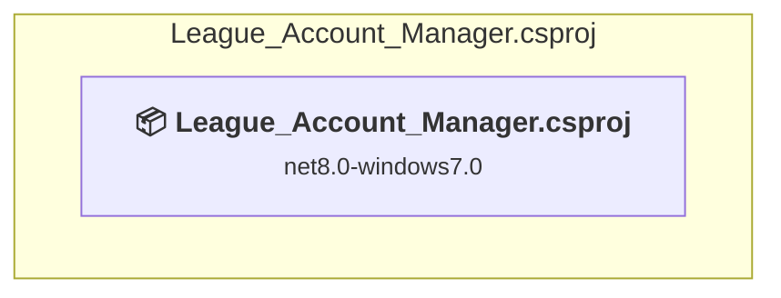

# Projects and dependencies analysis

This document provides a comprehensive overview of the projects and their dependencies in the context of upgrading to .NETCoreApp,Version=v10.0.

## Table of Contents

- [Executive Summary](#executive-Summary)
  - [Highlevel Metrics](#highlevel-metrics)
  - [Projects Compatibility](#projects-compatibility)
  - [Package Compatibility](#package-compatibility)
  - [API Compatibility](#api-compatibility)
- [Aggregate NuGet packages details](#aggregate-nuget-packages-details)
- [Top API Migration Challenges](#top-api-migration-challenges)
  - [Technologies and Features](#technologies-and-features)
  - [Most Frequent API Issues](#most-frequent-api-issues)
- [Projects Relationship Graph](#projects-relationship-graph)
- [Project Details](#project-details)

  - [League_Account_Manager\League_Account_Manager.csproj](#league_account_managerleague_account_managercsproj)

## Executive Summary

### Highlevel Metrics

| Metric | Count | Status |
| :--- | :---: | :--- |
| Total Projects | 1 | All require upgrade |
| Total NuGet Packages | 9 | 5 need upgrade |
| Total Code Files | 33 |  |
| Total Code Files with Incidents | 55 |  |
| Total Lines of Code | 13264 |  |
| Total Number of Issues | 3121 |  |
| Estimated LOC to modify | 3115+ | at least 23,5% of codebase |

### Projects Compatibility

| Project | Target Framework | Difficulty | Package Issues | API Issues | Est. LOC Impact | Description |
| :--- | :---: | :---: | :---: | :---: | :---: | :--- |
| [League_Account_Manager\League_Account_Manager.csproj](#league_account_managerleague_account_managercsproj) | net8.0-windows7.0 | 🟡 Medium | 5 | 3115 | 3115+ | Wpf, Sdk Style = True |

### Package Compatibility

| Status | Count | Percentage |
| :--- | :---: | :---: |
| ✅ Compatible | 4 | 44,4% |
| ⚠️ Incompatible | 3 | 33,3% |
| 🔄 Upgrade Recommended | 2 | 22,2% |
| ***Total NuGet Packages*** | ***9*** | ***100%*** |

### API Compatibility

| Category | Count | Impact |
| :--- | :---: | :--- |
| 🔴 Binary Incompatible | 2977 | High - Require code changes |
| 🟡 Source Incompatible | 41 | Medium - Needs re-compilation and potential conflicting API error fixing |
| 🔵 Behavioral change | 97 | Low - Behavioral changes that may require testing at runtime |
| ✅ Compatible | 13068 |  |
| ***Total APIs Analyzed*** | ***16183*** |  |

## Aggregate NuGet packages details

| Package | Current Version | Suggested Version | Projects | Description |
| :--- | :---: | :---: | :--- | :--- |
| CsvHelper | 33.0.1 |  | [League_Account_Manager.csproj](#league_account_managerleague_account_managercsproj) | ✅Compatible |
| FlaUI.UIA3 | 5.0.0 | 4.0.0 | [League_Account_Manager.csproj](#league_account_managerleague_account_managercsproj) | ⚠️NuGet package is incompatible |
| HtmlAgilityPack | 1.12.4 |  | [League_Account_Manager.csproj](#league_account_managerleague_account_managercsproj) | ✅Compatible |
| ini-parser | 2.5.2 |  | [League_Account_Manager.csproj](#league_account_managerleague_account_managercsproj) | ⚠️NuGet package is incompatible |
| Newtonsoft.Json | 13.0.3 | 13.0.4 | [League_Account_Manager.csproj](#league_account_managerleague_account_managercsproj) | NuGet package upgrade is recommended |
| NLog | 5.4.0 |  | [League_Account_Manager.csproj](#league_account_managerleague_account_managercsproj) | ✅Compatible |
| Notification.Wpf | 8.0.0 |  | [League_Account_Manager.csproj](#league_account_managerleague_account_managercsproj) | ✅Compatible |
| System.Drawing.Common | 9.0.2 | 10.0.5 | [League_Account_Manager.csproj](#league_account_managerleague_account_managercsproj) | NuGet package upgrade is recommended |
| WPF-UI | 4.2.0 | 2.0.3 | [League_Account_Manager.csproj](#league_account_managerleague_account_managercsproj) | ⚠️NuGet package is incompatible |

## Top API Migration Challenges

### Technologies and Features

| Technology | Issues | Percentage | Migration Path |
| :--- | :---: | :---: | :--- |
| WPF (Windows Presentation Foundation) | 1728 | 55,5% | WPF APIs for building Windows desktop applications with XAML-based UI that are available in .NET on Windows. WPF provides rich desktop UI capabilities with data binding and styling. Enable Windows Desktop support: Option 1 (Recommended): Target net9.0-windows; Option 2: Add <UseWindowsDesktop>true</UseWindowsDesktop>. |
| Legacy Cryptography | 2 | 0,1% | Obsolete or insecure cryptographic algorithms that have been deprecated for security reasons. These algorithms are no longer considered secure by modern standards. Migrate to modern cryptographic APIs using secure algorithms. |
| Windows Forms | 2 | 0,1% | Windows Forms APIs for building Windows desktop applications with traditional Forms-based UI that are available in .NET on Windows. Enable Windows Desktop support: Option 1 (Recommended): Target net9.0-windows; Option 2: Add <UseWindowsDesktop>true</UseWindowsDesktop>; Option 3 (Legacy): Use Microsoft.NET.Sdk.WindowsDesktop SDK. |

### Most Frequent API Issues

| API | Count | Percentage | Category |
| :--- | :---: | :---: | :--- |
| T:System.Windows.RoutedEventHandler | 200 | 6,4% | Binary Incompatible |
| T:System.Windows.Application | 87 | 2,8% | Binary Incompatible |
| T:System.Windows.Controls.DataGrid | 86 | 2,8% | Binary Incompatible |
| E:System.Windows.Controls.Primitives.ButtonBase.Click | 85 | 2,7% | Binary Incompatible |
| T:System.Windows.RoutedEventArgs | 85 | 2,7% | Binary Incompatible |
| T:System.Windows.Controls.TextBlock | 67 | 2,2% | Binary Incompatible |
| T:System.Windows.Threading.Dispatcher | 66 | 2,1% | Binary Incompatible |
| P:System.Windows.Threading.DispatcherObject.Dispatcher | 66 | 2,1% | Binary Incompatible |
| T:System.Windows.Controls.Label | 50 | 1,6% | Binary Incompatible |
| T:System.Windows.Thickness | 46 | 1,5% | Binary Incompatible |
| T:System.Windows.Visibility | 46 | 1,5% | Binary Incompatible |
| P:System.Windows.Controls.TextBox.Text | 46 | 1,5% | Binary Incompatible |
| T:System.Windows.MessageBoxResult | 45 | 1,4% | Binary Incompatible |
| T:System.Windows.MessageBoxImage | 44 | 1,4% | Binary Incompatible |
| T:System.Windows.Controls.TextBox | 44 | 1,4% | Binary Incompatible |
| T:System.Windows.Media.Brushes | 39 | 1,3% | Binary Incompatible |
| T:System.Windows.Media.SolidColorBrush | 39 | 1,3% | Binary Incompatible |
| T:System.Windows.MessageBoxButton | 36 | 1,2% | Binary Incompatible |
| P:System.Windows.Controls.ItemsControl.ItemsSource | 35 | 1,1% | Binary Incompatible |
| T:System.Windows.Window | 34 | 1,1% | Binary Incompatible |
| T:System.Windows.Controls.ItemCollection | 34 | 1,1% | Binary Incompatible |
| P:System.Windows.Controls.ItemsControl.Items | 34 | 1,1% | Binary Incompatible |
| T:System.Uri | 33 | 1,1% | Behavioral Change |
| T:System.Windows.Controls.Button | 33 | 1,1% | Binary Incompatible |
| P:System.Windows.Application.Current | 32 | 1,0% | Binary Incompatible |
| M:System.Windows.Threading.Dispatcher.Invoke(System.Action) | 30 | 1,0% | Binary Incompatible |
| P:System.Windows.Controls.ContentControl.Content | 29 | 0,9% | Binary Incompatible |
| T:System.Windows.Controls.ListBox | 29 | 0,9% | Binary Incompatible |
| T:System.Windows.Media.Brush | 27 | 0,9% | Binary Incompatible |
| T:System.Windows.Input.Key | 26 | 0,8% | Binary Incompatible |
| P:System.Windows.Controls.TextBlock.Text | 25 | 0,8% | Binary Incompatible |
| T:System.Windows.Controls.CheckBox | 25 | 0,8% | Binary Incompatible |
| M:System.Windows.Controls.Page.#ctor | 24 | 0,8% | Binary Incompatible |
| M:System.Uri.#ctor(System.String,System.UriKind) | 23 | 0,7% | Behavioral Change |
| T:System.Net.Http.HttpContent | 23 | 0,7% | Behavioral Change |
| M:System.Windows.Application.LoadComponent(System.Object,System.Uri) | 22 | 0,7% | Binary Incompatible |
| T:System.Windows.Input.MouseButtonEventHandler | 22 | 0,7% | Binary Incompatible |
| T:System.Windows.Markup.IComponentConnector | 21 | 0,7% | Binary Incompatible |
| M:System.TimeSpan.FromSeconds(System.Double) | 21 | 0,7% | Source Incompatible |
| M:System.Windows.Window.#ctor | 20 | 0,6% | Binary Incompatible |
| T:System.Windows.Controls.UIElementCollection | 19 | 0,6% | Binary Incompatible |
| P:System.Windows.Controls.Panel.Children | 19 | 0,6% | Binary Incompatible |
| T:System.Windows.Input.KeyEventHandler | 18 | 0,6% | Binary Incompatible |
| T:System.Windows.Controls.ScrollBarVisibility | 18 | 0,6% | Binary Incompatible |
| M:System.Windows.Controls.UIElementCollection.Add(System.Windows.UIElement) | 17 | 0,5% | Binary Incompatible |
| T:System.Windows.Controls.StackPanel | 16 | 0,5% | Binary Incompatible |
| T:System.Windows.Controls.Grid | 16 | 0,5% | Binary Incompatible |
| P:System.Windows.Controls.Primitives.Selector.SelectedItem | 16 | 0,5% | Binary Incompatible |
| P:System.Windows.FrameworkElement.Margin | 15 | 0,5% | Binary Incompatible |
| P:Microsoft.Win32.FileDialog.FileName | 15 | 0,5% | Binary Incompatible |

## Projects Relationship Graph

Legend:
📦 SDK-style project
⚙️ Classic project

## Project Details

### League_Account_Manager\League_Account_Manager.csproj

#### Project Info

- **Current Target Framework:** net8.0-windows7.0
- **Proposed Target Framework:** net10.0-windows
- **SDK-style**: True
- **Project Kind:** Wpf
- **Dependencies**: 0
- **Dependants**: 0
- **Number of Files**: 34
- **Number of Files with Incidents**: 55
- **Lines of Code**: 13264
- **Estimated LOC to modify**: 3115+ (at least 23,5% of the project)

#### Dependency Graph

Legend:
📦 SDK-style project
⚙️ Classic project

### API Compatibility

| Category | Count | Impact |
| :--- | :---: | :--- |
| 🔴 Binary Incompatible | 2977 | High - Require code changes |
| 🟡 Source Incompatible | 41 | Medium - Needs re-compilation and potential conflicting API error fixing |
| 🔵 Behavioral change | 97 | Low - Behavioral changes that may require testing at runtime |
| ✅ Compatible | 13068 |  |
| ***Total APIs Analyzed*** | ***16183*** |  |

#### Project Technologies and Features

| Technology | Issues | Percentage | Migration Path |
| :--- | :---: | :---: | :--- |
| Legacy Cryptography | 2 | 0,1% | Obsolete or insecure cryptographic algorithms that have been deprecated for security reasons. These algorithms are no longer considered secure by modern standards. Migrate to modern cryptographic APIs using secure algorithms. |
| Windows Forms | 2 | 0,1% | Windows Forms APIs for building Windows desktop applications with traditional Forms-based UI that are available in .NET on Windows. Enable Windows Desktop support: Option 1 (Recommended): Target net9.0-windows; Option 2: Add <UseWindowsDesktop>true</UseWindowsDesktop>; Option 3 (Legacy): Use Microsoft.NET.Sdk.WindowsDesktop SDK. |
| WPF (Windows Presentation Foundation) | 1728 | 55,5% | WPF APIs for building Windows desktop applications with XAML-based UI that are available in .NET on Windows. WPF provides rich desktop UI capabilities with data binding and styling. Enable Windows Desktop support: Option 1 (Recommended): Target net9.0-windows; Option 2: Add <UseWindowsDesktop>true</UseWindowsDesktop>. |

