# League Account Manager

[](https://github.com/Ja-Sa-La/League-Account-Manager/releases/latest)
[](https://github.com/Ja-Sa-La/League-Account-Manager/releases)

A Windows WPF utility for managing League of Legends accounts, client data,
loot, profiles, friends, and in-client workflows from one place. The
application uses the League Client API (LCU) and does not use autoclickers or
game exploits.

For support, join the [Discord server](https://discord.gg/tjQVcc9SGP).

## Download

| Channel | Version | Download |
| --- | --- | --- |
| Stable | [2.7.0.24](https://github.com/Ja-Sa-La/League-Account-Manager/releases/tag/v2.7.0.24) | [Download latest stable](https://github.com/Ja-Sa-La/League-Account-Manager/releases/latest) |
| Beta | [2.7.0.29-beta](https://github.com/Ja-Sa-La/League-Account-Manager/releases/tag/v2.7.0.29-beta) | [Download latest beta](https://github.com/Ja-Sa-La/League-Account-Manager/releases/tag/v2.7.0.29-beta) |

Beta builds contain the newest features and may be less stable. The current
beta adds the Valorant loadout manager described below.

## Features

- **Account management:** Store accounts locally in CSV format, optionally encrypt
  data with AES-GCM, share account files, and log in with a click.
- **Account data:** Save and search rank, level, champions, skins, loot, notes,
  regions, and calculated loot value.
- **Client tools:** Champion buyer, loot manager, disenchanter, queue helpers,
  configurable auto-accept, and stealth login.
- **Profile and social tools:** Profile editor, Riot ID changer, friend manager,
  bulk friend removal, and log cleanup.
- **Game workflow tools:** Champion select assistance, player stats where Riot
  permits them, rune pages, and an improved report tool.
- **Valorant:** Account list, inventory, and a loadout manager that equips owned
  skins, chromas, and the highest owned skin level. Saved sets can apply
  automatically when an agent is selected.
- **Diagnostics:** LCU traffic viewer, request logging, debug mode, and utility
  tools for inspecting client data.
- **Extensibility:** Trusted plugins can add navigation pages, XAML-based WPF
  views, page icons, LCU requests, and authenticated storefront requests.

See the [full feature documentation](docs/index.md) for screenshots and
individual tool guides.

## Plugin platform

The beta release introduces a plugin system for developers who want to extend
the application with native WPF pages. Plugins are regular .NET class
libraries, can use normal XAML and code-behind, and receive host-mediated LCU
and storefront clients through `IPluginContext`.

- [Plugin development guide](docs/pages/plu29ns.md)
- [Example plugin source](Examples/ExamplePlugin)
- [Plugin contract](League_Account_Manager.PluginContract)
- [Beta release notes](docs/releases/2.7.0.16-beta.md)

Plugins are trusted, in-process assemblies and are **not sandboxed**. Only
install plugins from sources you trust. The host creates the `Plugins` folder
automatically; restart the application after adding or updating a plugin.

## Screenshots

### Accounts
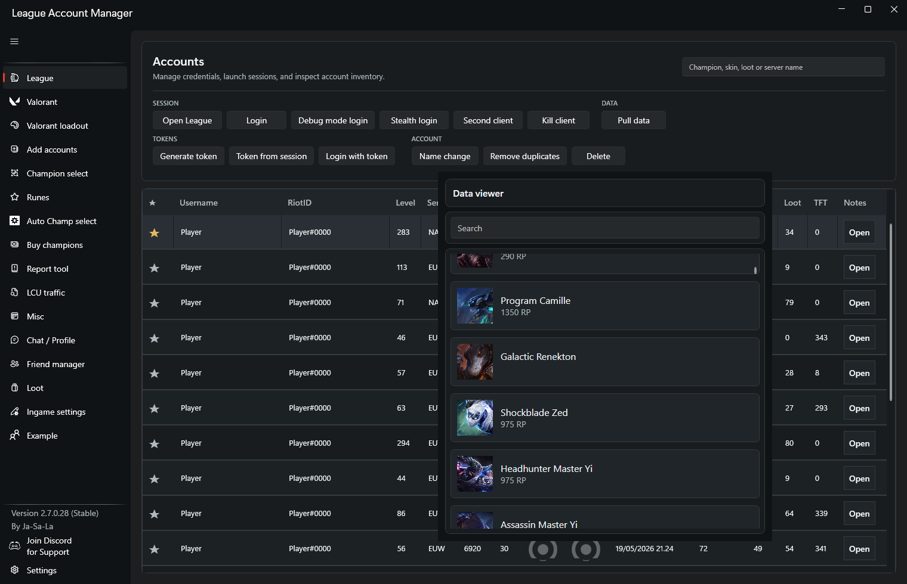

### Account data
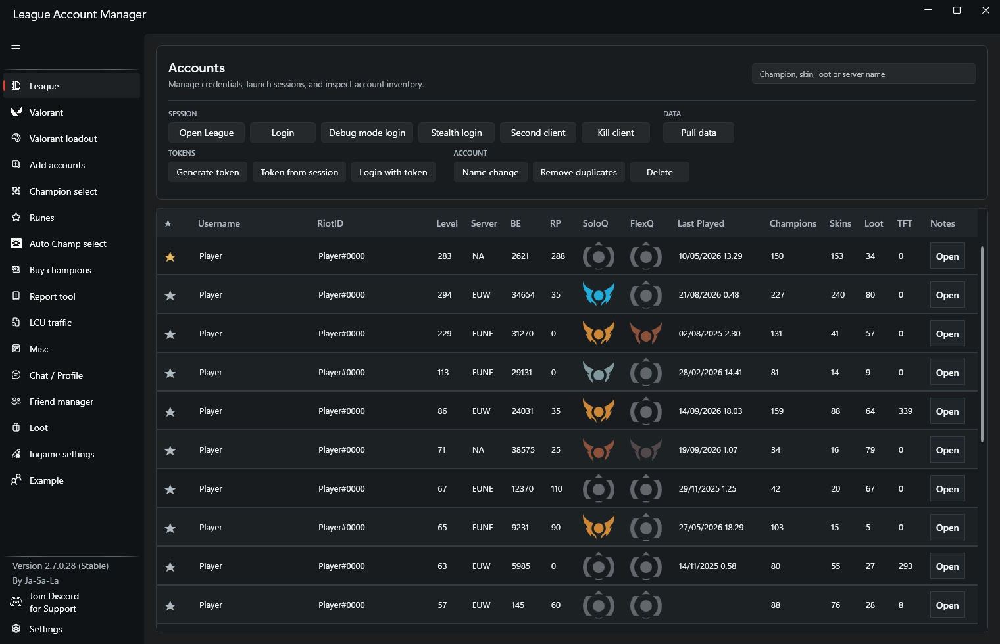

### Add accounts
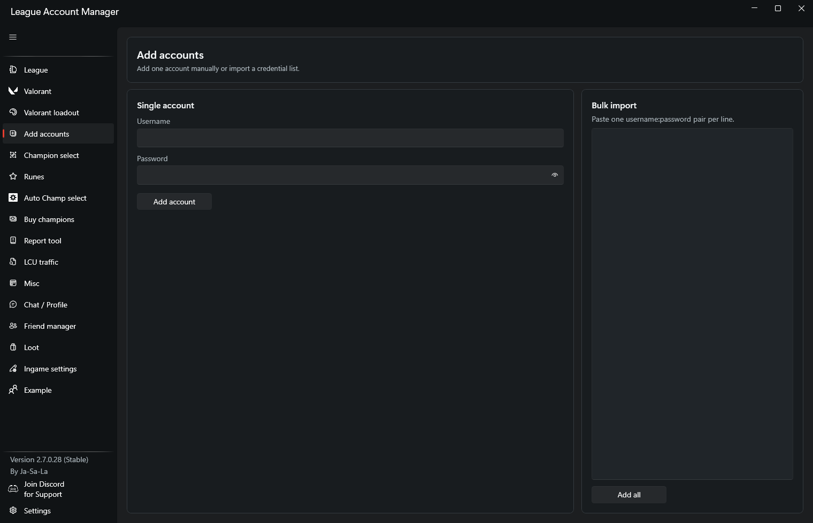

### Valorant accounts
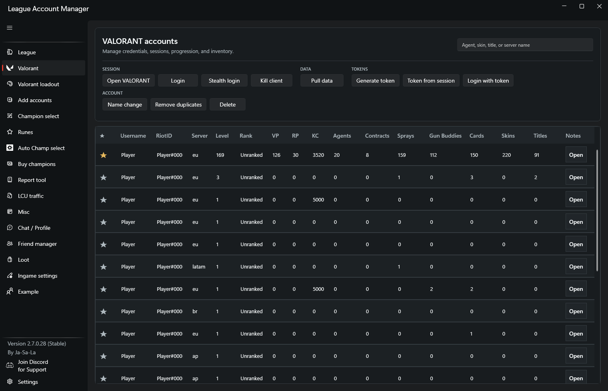

### Valorant inventory
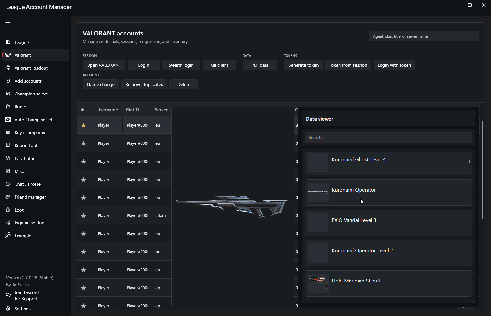

### Valorant loadout
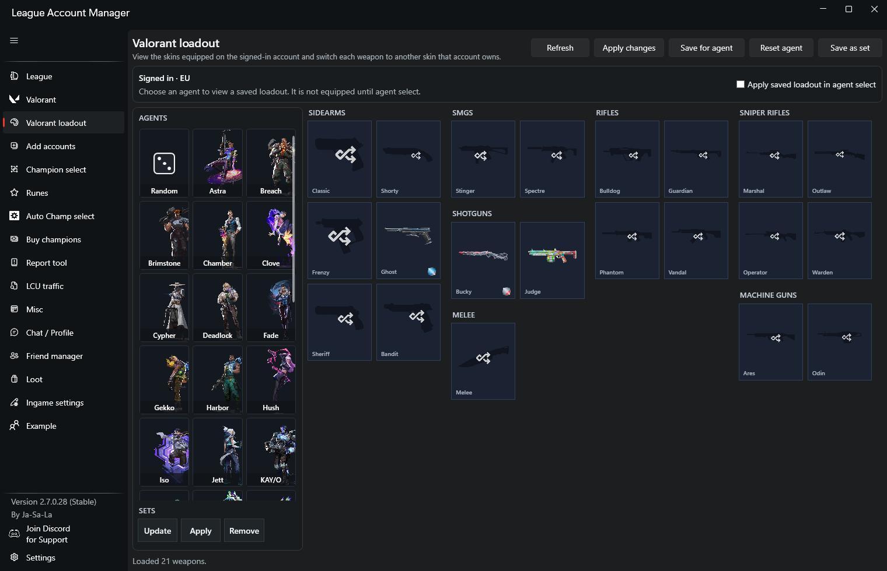

### Champion select
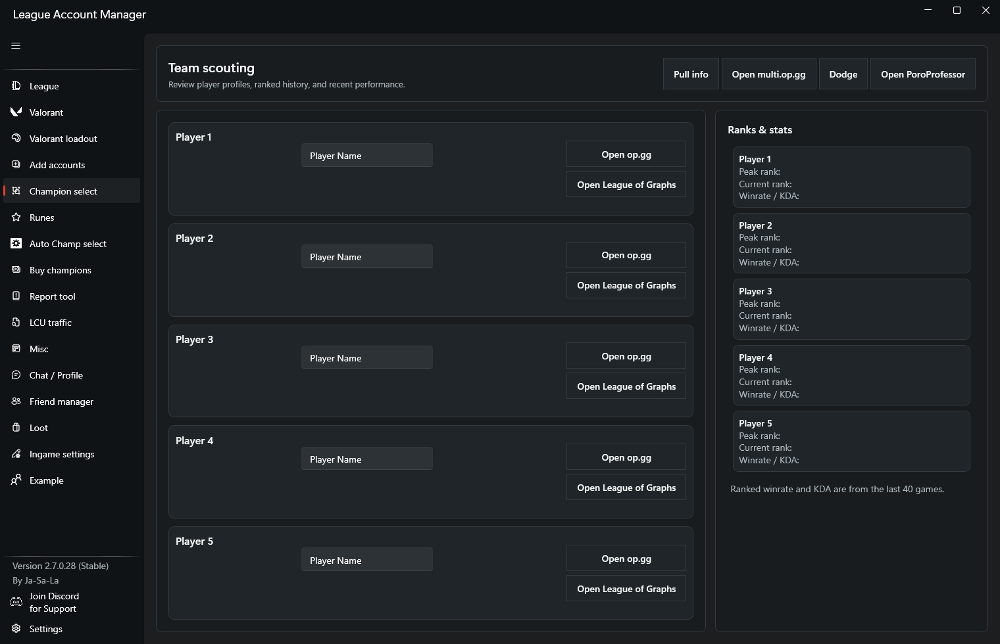

### Auto champion select
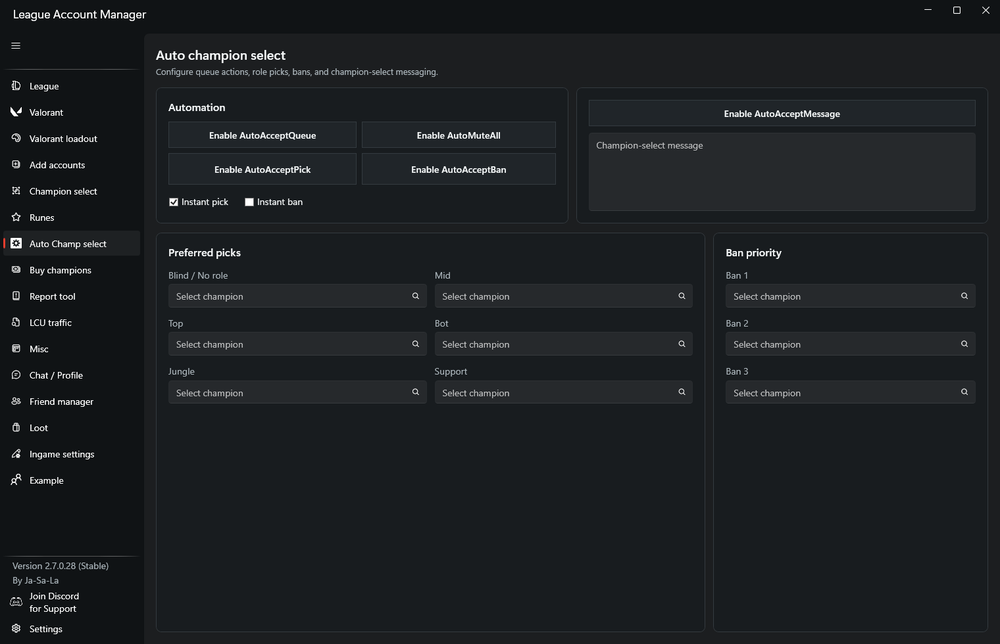

### Runes
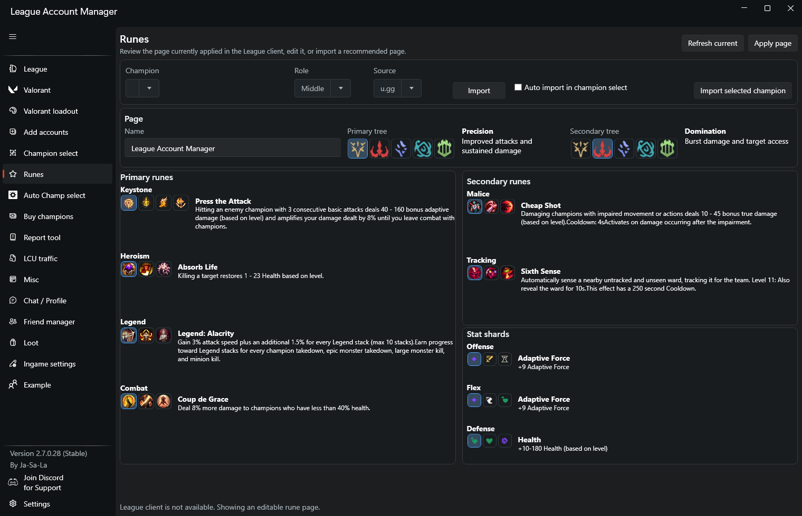

### Champion buyer
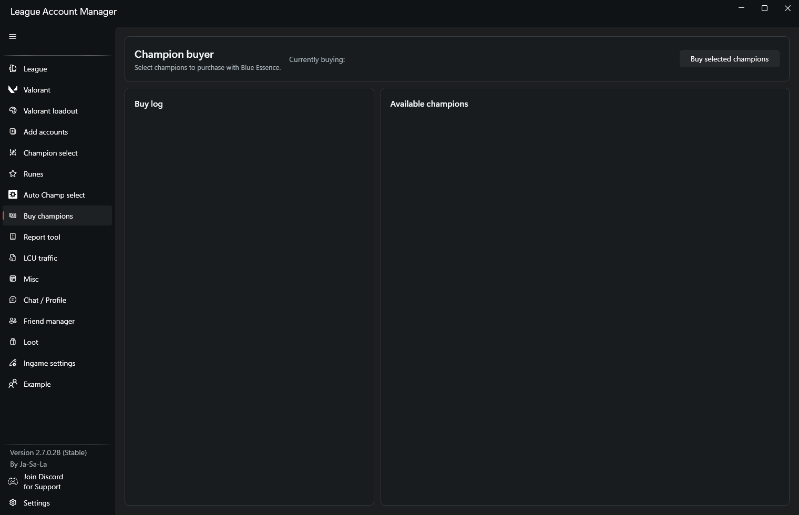

### Report tool
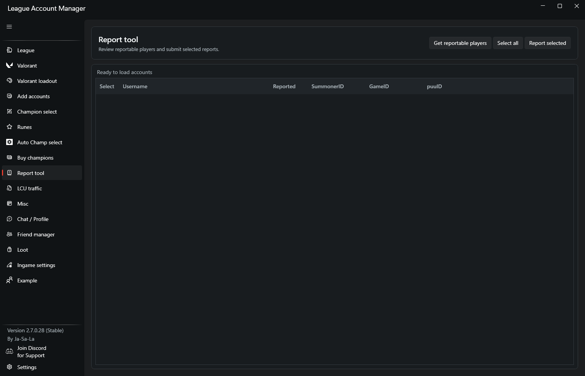

### LCU traffic
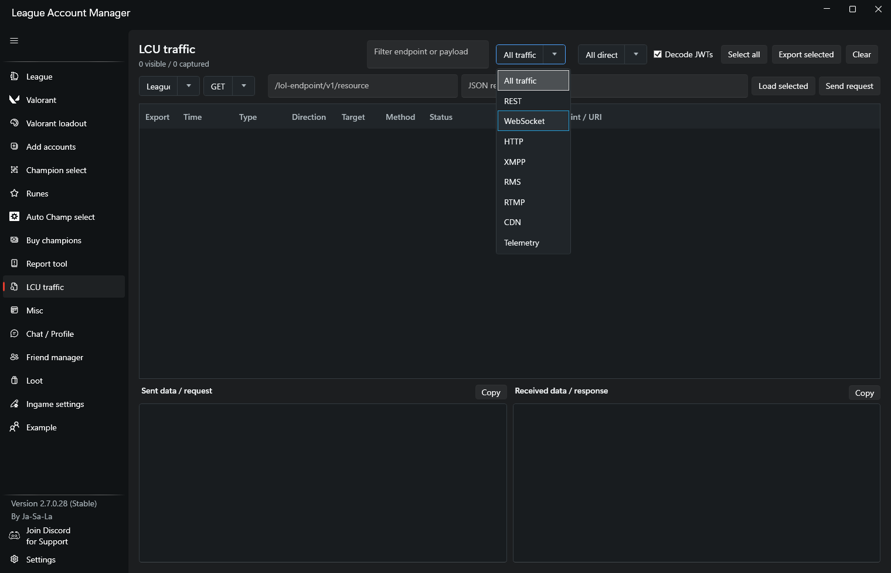

##Accounts list and search
- Valorant accounts and loadout manager
- Add accounts
- Champion select and auto champion select
- Runes
- Champion buyer
- Disenchanter / Loot manager
- Report tool
- LCU traffic
- Misc tools (log cleanup, queue helpers, loot value, etc.)
- Profile editor (icon/status/background)
- Friend manager (bulk remove)
- In-game settings
### Loot
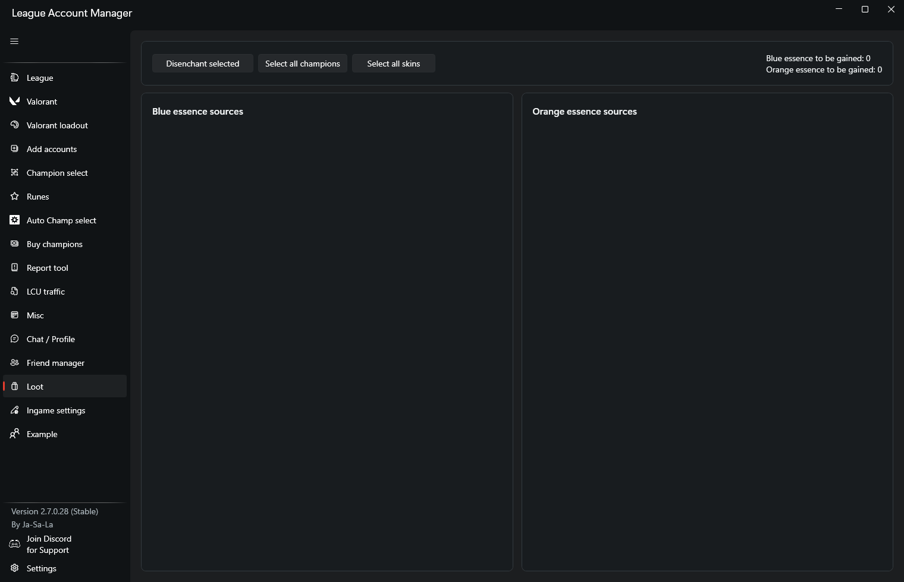

### In-game settings
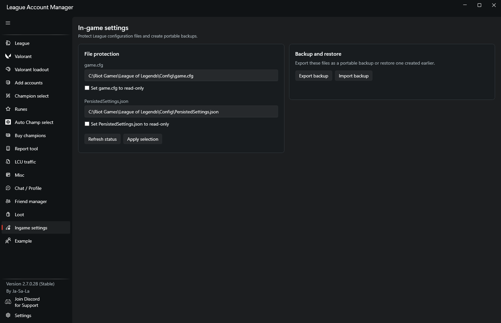

### Settings
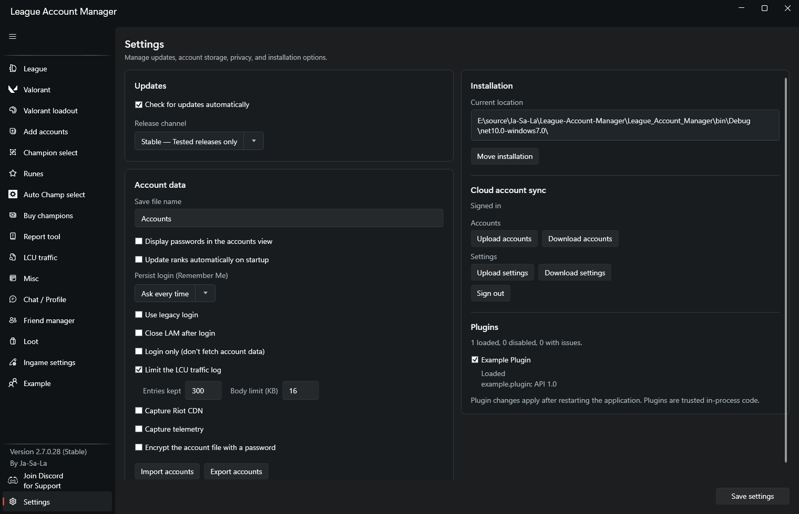


## UI Pages / Tools

- Dashboard / Home
- Accounts list and search
- Champion Buyer
- Disenchanter / Loot Manager
- Misc Tools (log cleanup, queue helpers, loot value, etc.)
- Profile Editor (icon/status/background)
- Change Riot ID
- Friend Manager (Display inactive ones and bulk remove)
- Report Tool
- Settings

## Requirements

- Windows x64
- .NET 10 Desktop Runtime for the packaged app
- .NET 10 SDK for building and testing from source

## Install & Run (binary)

1. [Download the latest stable release](https://github.com/Ja-Sa-La/League-Account-Manager/releases/latest)
	or [latest beta](https://github.com/Ja-Sa-La/League-Account-Manager/releases).
2. Install the .NET 10 Desktop Runtime.
3. Run `League_Account_Manager.exe`.
4. If League permissions block an operation, start the app as Administrator.

## Build from Source

```powershell
git clone https://github.com/Ja-Sa-La/League-Account-Manager.git
cd League-Account-Manager
dotnet restore
dotnet build League_Account_Manager/League_Account_Manager.csproj -c Release
dotnet run --project League_Account_Manager/League_Account_Manager.csproj
```

Windows batch scripts are also available from the repository root:

```bat
build.bat
test.bat
publish.bat
```

`build.bat` and `test.bat` default to Release. Pass `Debug` as the first argument to use the Debug configuration. `publish.bat` creates a framework-dependent, single-file `win-x64` build in `artifacts\win-x64`.

## Tests

```powershell
dotnet test League_Account_Manager.Tests/League_Account_Manager.Tests.csproj
```

See [Testing](docs/testing.md) for coverage commands and integration-test boundaries.

## Documentation

- [Documentation home](docs/index.md)
- [Plugin development](docs/pages/plugins.md)
- [Testing and coverage](docs/testing.md)
- [Main window](docs/pages/main-window.md)
- [Accounts](docs/pages/accounts.md)
- [Champion buyer](docs/pages/champion-buyer.md)
- [Champion select](docs/pages/champion-select.md)
- [LCU traffic](docs/pages/lcu-traffic.md)
- [Profile editor](docs/pages/profile-editor.md)
- [Settings](docs/pages/settings.md)
- [Release notes](docs/releases)

## Privacy & Safety

- All account data stays on your machine (local CSV)
- Uses LCU endpoints and host-mediated storefront requests; no automation via autoclickers
- Account credentials, exported files, and debug logs may contain sensitive data

## Troubleshooting

- Run as Administrator if file access or League permissions fail.
- Ensure the League Client is running when using LCU-dependent features.
- Close the application before rebuilding or replacing plugin DLLs.
- See the [plugin troubleshooting guide](docs/pages/plugins.md#troubleshooting)
	for plugin loading, XAML page, contract, and locked-DLL issues.

## Contributing

PRs and issues are welcome. Please read the relevant [developer
documentation](docs/index.md), run the test suite, and keep changes within
Riot's ToS and LCU guidelines.
