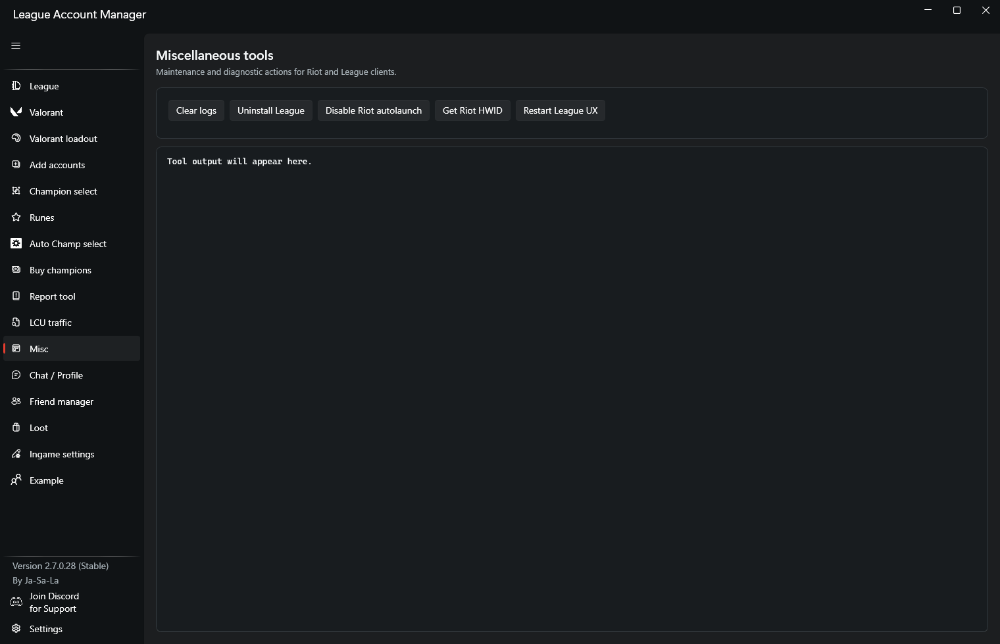
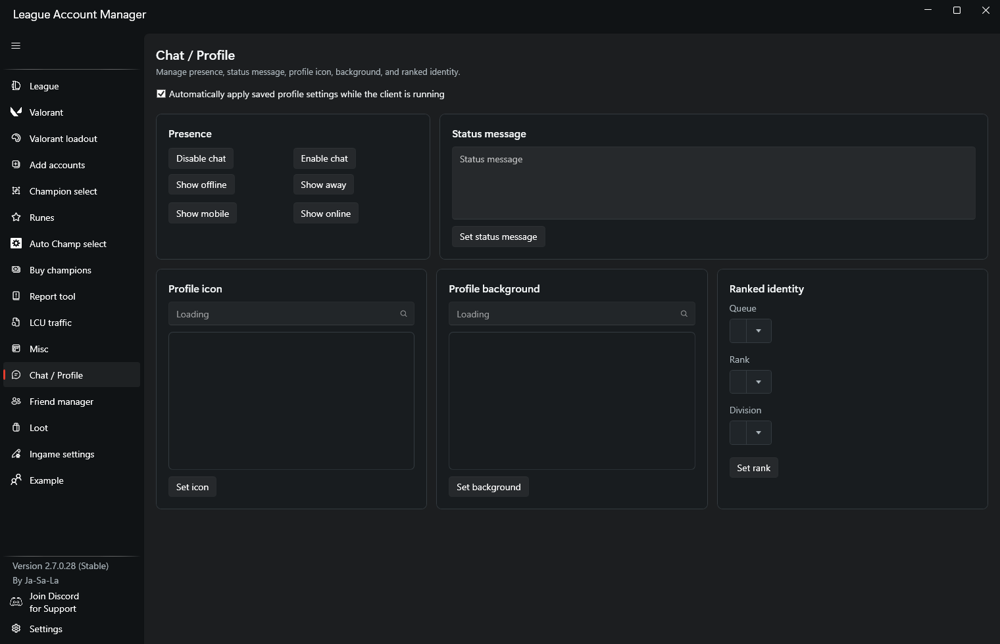
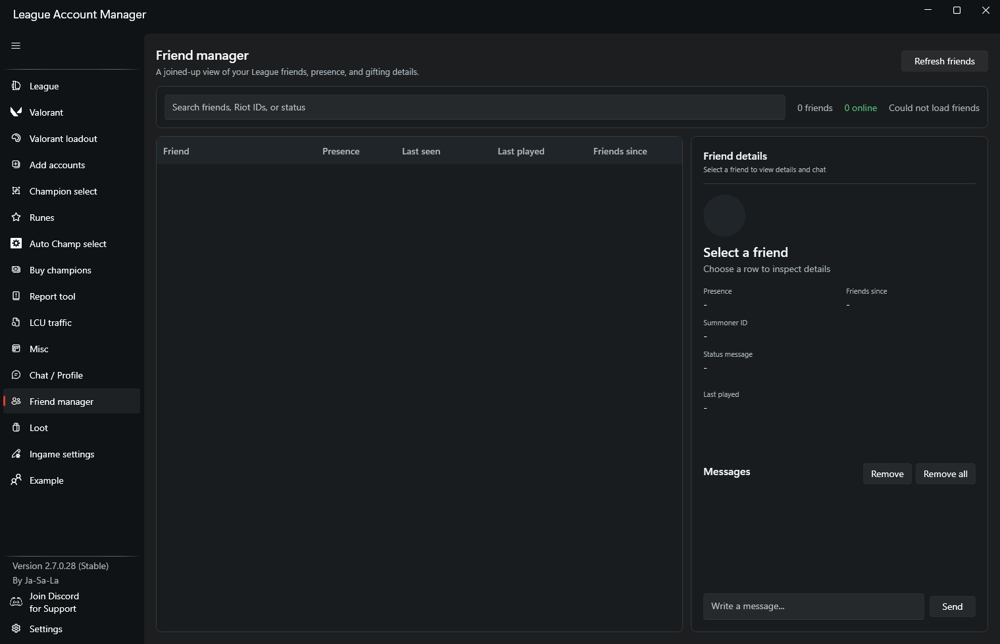

This site documents the app, its features, and the WPF pages in the UI.

## Features

- Store accounts locally (CSV) (optionally you can encrypt the data with AES-GCM) and log in with a click
- Share accounts without ever having to give your password to anyone
- Save rank, level, champions, skins, loot, and notes per account
- Search accounts by region, loot value, champions, and skins
- Champion buyer (quick purchase flow)
- Loot manager and disenchanter
- Queue auto-accept (configurable)
- Player stats in champ select (queues allowed by Riot only)
- Profile editor (icon, banner, status, background)
- Riot ID changer
- Friend management (bulk remove) and log cleanup
- Report tool with improved post-game UI
- Misc tools: log remover, loot value checker, queue helpers, etc.
- Stealth login (launch/login without showing yourself online)
- Debug mode login and LCU traffic inspection
- Automatic update checks and optional beta releases
- Optional cloud account and settings synchronization with encrypted payloads
- OPAQUE-based cloud authentication with sessions protected for the current Windows user

## Screenshots

### Accounts


### Account data


### Add accounts


### Valorant accounts


### Valorant inventory


### Valorant loadout


### Champion select


### Auto champion select


### Runes


### Champion buyer


### Report tool


### LCU traffic


### Misc tools


### Profile editor


### Friend manager


### Loot


### In-game settings


### Settings


## Pages

- [Plugin Development](pages/plugins.md)
- [Main Window](pages/main-window.md)
- [Accounts](pages/accounts.md)
- [Valorant Loadout](pages/valorant-loadout.md)
- [Add Accounts](pages/add-accounts.md)
- [Autolobby](pages/autolobby.md)
- [Champion Buyer](pages/champion-buyer.md)
- [Champion Select](pages/champion-select.md)
- [Disenchanter](pages/disenchanter.md)
- [Misc Tools](pages/misc-tools.md)
- [Profile Editor](pages/profile-editor.md)
- [Report Tool](pages/report-tool.md)
- [LCU Traffic](pages/lcu-traffic.md)
- [Settings](pages/settings.md)
- [Settings Editor](pages/settings-editor.md)
- [Change Name](pages/change-name.md)
- [Display Data With Search](pages/display-data-with-search.md)
- [Missing Info](pages/missing-info.md)
- [Note Display](pages/note-display.md)
- [Password Prompt](pages/password-prompt.md)
- [Progress Window](pages/progress-window.md)
- [Remove Friends Confirmation](pages/remove-friends-confirmation.md)

## Requirements

- Windows
- .NET 10 Desktop Runtime for the packaged app
- .NET 10 SDK for building and testing from source

## Install & Run (binary)

<a href="https://github.com/Ja-Sa-La/League-Account-Manager/releases" class="download-button">Download Latest Release</a>

1. [Download](https://github.com/Ja-Sa-La/League-Account-Manager/releases) the latest release build
2. Ensure .NET 10 Desktop Runtime is installed
3. Run `League Account Manager.exe`
4. If League permissions block some operations, start the app as Administrator

## Build from Source

```powershell
git clone https://github.com/Ja-Sa-La/League-Account-Manager.git
cd League-Account-Manager
dotnet restore
dotnet build League_Account_Manager/League_Account_Manager.csproj -c Release
dotnet run --project League_Account_Manager/League_Account_Manager.csproj
```

## Cloud Sync & Privacy

- All account data stays on your machine (local CSV)
- Cloud synchronization is opt-in and requires signing in from the Settings page.
- Account and settings sync payloads are encrypted in the app with AES-256-GCM before upload.
- Account and settings data use separate derived encryption keys; the sync service does not receive the plaintext data.
- The OPAQUE authentication flow is designed so the cloud service does not receive the account password in plaintext.
- A saved cloud session is protected with Windows DPAPI for the current Windows user and is discarded when it is no longer usable.
- Uses only LCU endpoints; no automation via autoclickers
- Account credentials and captured traffic may contain sensitive data; protect exported files and debug logs.

## Troubleshooting

- Run as Administrator if file access or League permissions fail
- Ensure the League Client is running when using LCU-dependent features

## Contributing

PRs and issues are welcome. Please keep changes within Riot’s ToS and LCU guidelines.

## Technical details

- UI framework: WPF on .NET 10 (`net10.0-windows7.0`) with WPF-UI controls.
- Each page uses a XAML view and a code-behind file (for example, `views/Accounts.xaml` and `views/Accounts.xaml.cs`).
- Windows and dialogs live under `Windows` and are opened by the main workflow as needed.

## Tutorials

For each page, open the relevant view from the main window, follow the steps listed on that page, and return here for navigation.

## Release channels

- Stable: tested releases only.
- Beta: early access to new features and fixes; beta builds may contain bugs.
